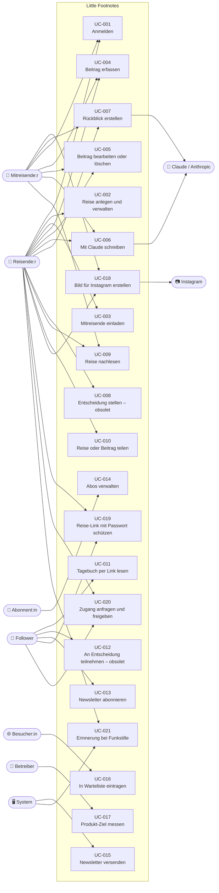

# Use Cases – Übersicht

Abgeleitet aus [requirements.md](requirements.md). Detaillierte Spezifikationen aller Use Cases liegen in [use_cases/](use_cases/) (verlinkt in der Tabelle).

`UC-008` und `UC-012` sind obsolet (Entscheidungen ausgebaut, 2026-11-27). `UC-019` und `UC-020` sind Konzepte (Status `Draft`), noch nicht gebaut. `UC-006` und `UC-007` setzen die KI-Einwilligung voraus (FR-030). Mitreisende werden durch `UC-003` zu Mitgliedern
der Reise.

## Rückverfolgbarkeit

| Use Case | Titel                           | Akteure                       | Anforderungen                          |
| -------- | ------------------------------- | ----------------------------- | -------------------------------------- |
| [UC-001](use_cases/UC-001-anmelden.md) | Anmelden                        | Reisende:r, Mitreisende:r     | FR-001                                 |
| [UC-002](use_cases/UC-002-reise-anlegen-und-verwalten.md) | Reise anlegen und verwalten     | Reisende:r                    | FR-002, FR-003, FR-006, FR-082         |
| [UC-003](use_cases/UC-003-mitreisende-einladen.md) | Mitreisende einladen            | Reisende:r, Mitreisende:r     | FR-004, FR-005                         |
| [UC-004](use_cases/UC-004-beitrag-erfassen.md) | Beitrag erfassen                | Reisende:r, Mitreisende:r     | FR-010 – FR-016, FR-021, FR-045        |
| [UC-005](use_cases/UC-005-beitrag-bearbeiten-oder-loeschen.md) | Beitrag bearbeiten oder löschen | Reisende:r, Mitreisende:r     | FR-015, FR-018, FR-019, FR-047         |
| [UC-006](use_cases/UC-006-mit-claude-schreiben.md) | Mit Claude schreiben            | Reisende:r, Mitreisende:r     | FR-030 – FR-033, FR-035                |
| [UC-007](use_cases/UC-007-rueckblick-erstellen.md) | Rückblick erstellen             | Reisende:r, Mitreisende:r     | FR-030, FR-034                         |
| [UC-008](use_cases/UC-008-entscheidung-stellen.md) | Entscheidung stellen            | Reisende:r                    | FR-020                                 |
| [UC-009](use_cases/UC-009-reise-nachlesen.md) | Reise nachlesen                 | Reisende:r, Mitreisende:r     | FR-040 – FR-044, FR-046, FR-070 – FR-072 |
| [UC-010](use_cases/UC-010-reise-oder-beitrag-teilen.md) | Reise oder Beitrag teilen       | Reisende:r                    | FR-050 – FR-052                        |
| [UC-011](use_cases/UC-011-tagebuch-per-link-lesen.md) | Tagebuch per Link lesen         | Follower                      | FR-017, FR-053 – FR-055                |
| [UC-012](use_cases/UC-012-an-entscheidung-teilnehmen.md) | An Entscheidung teilnehmen      | Follower                      | FR-056                                 |
| [UC-013](use_cases/UC-013-newsletter-abonnieren.md) | Newsletter abonnieren           | Follower                      | FR-060, FR-061                         |
| [UC-014](use_cases/UC-014-abos-verwalten.md) | Abos verwalten                  | Abonnent:in, Reisende:r       | FR-062, FR-063, FR-065                 |
| [UC-015](use_cases/UC-015-newsletter-versenden.md) | Newsletter versenden            | System                        | FR-064                                 |
| [UC-016](use_cases/UC-016-in-warteliste-eintragen.md) | In Warteliste eintragen         | Besucher:in                   | FR-073, FR-074                         |
| [UC-017](use_cases/UC-017-produkt-ziel-messen.md) | Produkt-Ziel messen             | Betreiber                     | FR-080, FR-081, FR-083                 |
| [UC-018](use_cases/UC-018-bild-fuer-instagram-erstellen.md) | Bild für Instagram erstellen | Reisende:r, Mitreisende:r | FR-047, FR-057 – FR-059 |
| [UC-019](use_cases/UC-019-reise-link-mit-passwort-schuetzen.md) | Reise-Link mit Passwort schützen | Reisende:r, Follower | FR-090 – FR-095 |
| [UC-020](use_cases/UC-020-zugang-anfragen-und-freigeben.md) | Zugang anfragen und freigeben | Follower, Reisende:r | FR-096 – FR-099 |
| [UC-021](use_cases/UC-021-erinnerung-bei-funkstille.md) | Erinnerung bei Funkstille | System, Reisende:r | FR-084, FR-085 |
